# 00 — Image baseline

**Track:** PC series (M0) · **Status:** In progress

Procedural test images with exact ground truth, used as the reference for the filtering and denoising experiments.

```bash
python run.py --config configs/default.json
```

## Test patterns

$u \in [0, W-1]$: column, $v \in [0, H-1]$: row. Values are linear intensities in $[0, 1]$.

| Pattern | Definition | Preview |
|---|---|---|
| `gradient` | $x = \dfrac{u}{W-1}$ | 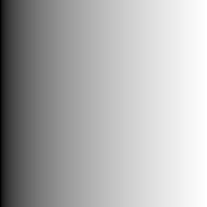 |
| `diagonal_gradient` | $x = \dfrac12\left(\dfrac{u}{W-1} + \dfrac{v}{H-1}\right)$ |  |
| `step_edge` | $x = [\,u \ge W/2\,]$ |  |
| `checkerboard` | $x = \left(\lfloor u/k \rfloor + \lfloor v/k \rfloor\right) \bmod 2$ | 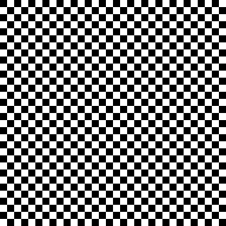 |
| `flat` | $x = c$ |  |
| `zone_plate` | $x = \tfrac12 + \tfrac12\cos(\alpha r^2)$, $\ \alpha = \pi f_{max} / r_{max}$ |  |

Zone plate: $r$ is the distance from the centre $\left(\frac{W-1}{2}, \frac{H-1}{2}\right)$, $r_{max}$ the centre-to-corner distance; local frequency $f(r) = \alpha r / \pi$ cycles/pixel.

## Noise

$$y = x + \sigma_n z, \qquad z[v,u] \sim \mathcal{N}(0, 1) \ \text{i.i.d.}$$

- $z$: one standard-normal field per image size, generator seeded with $(\text{seed}, W, H)$; shared across patterns and $\sigma_n$.
- $y$ is not clipped, so $\mathbb{E}[y - x] = 0$ at every pixel.

| Pattern | Clean | $\sigma_n = 0.05$ | $\sigma_n = 0.2$ |
|---|---|---|---|
| `step_edge` |  | 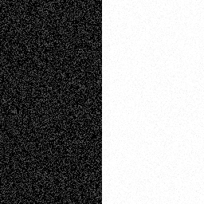 | 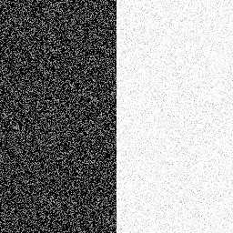 |
| `zone_plate` | 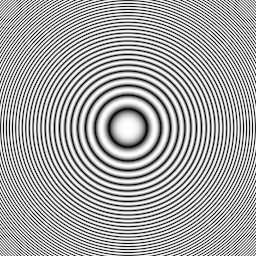 | 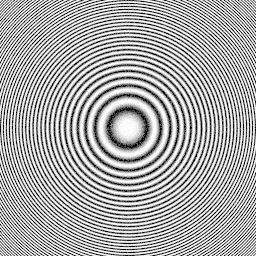 | 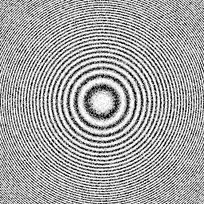 |

**Note:** only the PNG previews are clipped to $[0, 1]$; all computations use the unclipped values.

## Filters

| Filter | Definition |
|---|---|
| `no_filter` | $\hat{x} = y$ |
| `gaussian_direct` | $\hat{x}[v,u] = \sum\limits_{j=-R}^{R}\sum\limits_{i=-R}^{R} w_j\, w_i\; y\big[c_v(v+j),\, c_u(u+i)\big]$ |
| `gaussian_separable` | $t[v,u] = \sum\limits_{i} w_i\, y\big[v,\, c_u(u+i)\big], \qquad \hat{x}[v,u] = \sum\limits_{j} w_j\, t\big[c_v(v+j),\, u\big]$ |

Kernel and boundary:

$$w_i = \frac{e^{-i^2/2\sigma^2}}{\sum_{k=-R}^{R} e^{-k^2/2\sigma^2}}, \qquad R = \lceil 3\sigma \rceil, \qquad c_u(u) = \min(\max(u, 0), W-1)$$

| | Taps per pixel | $\sigma = 4$ |
|---|---|---|
| Direct | $(2R+1)^2$ | 625 |
| Separable | $2(2R+1)$ | 50 |

Direct and separable agree to $\max|\Delta| = 3.1 \times 10^{-15}$ (float64 rounding) for both image sizes and all $\sigma$.

### Evaluation order

Both orders compute the same sum.

```
Per pixel (pixel shader)                Per tap (this implementation)
for each pixel (v, u):                  for each tap (j, i):
    for each tap (j, i):                    out += w[j,i] * shift(y_padded, j, i)   ← whole H×W image
        out[v,u] += w[j,i] * y[v+j, u+i]
```

1D example, $w = [0.25, 0.5, 0.25]$, clamped border:

| | $u=0$ | $u=1$ | $u=2$ | $u=3$ | $u=4$ |
|---|---|---|---|---|---|
| $y$ shifted by $-1$ | 1 | 1 | 2 | 3 | 4 |
| $y$ | 1 | 2 | 3 | 4 | 5 |
| $y$ shifted by $+1$ | 2 | 3 | 4 | 5 | 5 |
| $\hat{x}$ (weighted column sum) | 1.25 | 2.0 | 3.0 | 4.0 | 4.75 |

Each row is one tap applied to every pixel; each column is one pixel's neighbourhood. The per-tap order turns the inner loop into a single vectorised NumPy array operation, leaving only $(2R+1)^2$ (or $2(2R+1)$) interpreted iterations instead of one per pixel and tap.

### Results

$\sigma_n = 0.1$, 256×256.

| Pattern | Noisy | $\sigma = 1$ | $\sigma = 2$ | $\sigma = 4$ |
|---|---|---|---|---|
| `step_edge` | 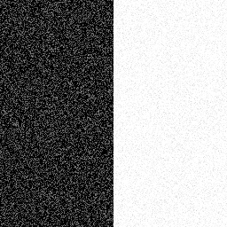 | 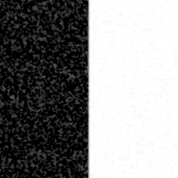 | 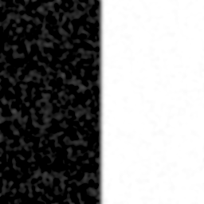 |  |
| `checkerboard` | 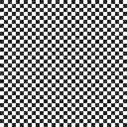 | 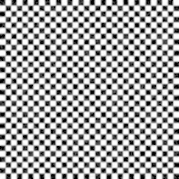 | 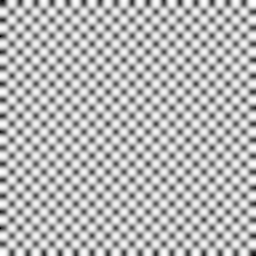 |  |
| `zone_plate` | 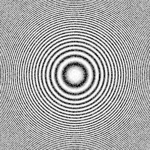 | 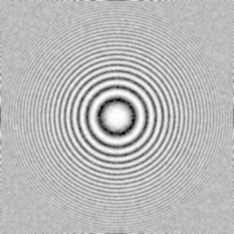 | 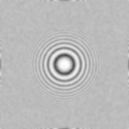 | 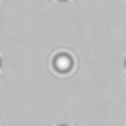 |

## Metrics

$$\text{MSE} = \frac{1}{HW}\sum_{v,u}\big(\hat{x}[v,u] - x[v,u]\big)^2, \qquad \text{PSNR} = 10\log_{10}\frac{\text{peak}^2}{\text{MSE}}\ \ \text{[dB]}, \qquad \text{PSNR} = \infty \text{ if MSE} = 0$$

peak $= 1$ (linear $[0, 1]$ data). $+6$ dB $\approx$ RMS error halved.

All results: `results/<config>/metrics.csv` (pattern, size, $\sigma_n$, filter, MSE, PSNR).

### Noise-only check

`flat`, 256×256, $\sigma_n = 0.1$. Zero bias, so $\text{MSE} = \sigma_n^2 \left(\sum_i w_i^2\right)^2$ (interior; clamped borders average fewer independent samples, hence slightly higher measured values).

| Filter | MSE measured | MSE expected | PSNR [dB] |
|---|---|---|---|
| `no_filter` | 9.995e-3 | 1.000e-2 | 20.00 |
| Gaussian $\sigma = 0.5$ | 4.134e-3 | 4.113e-3 | 23.84 |
| Gaussian $\sigma = 1$ | 8.113e-4 | 7.968e-4 | 30.91 |
| Gaussian $\sigma = 2$ | 2.043e-4 | 1.998e-4 | 36.90 |
| Gaussian $\sigma = 4$ | 5.370e-5 | 5.008e-5 | 42.70 |

### PSNR by pattern

PSNR [dB], 256×256, $\sigma_n = 0.1$.

| Pattern | `no_filter` | $\sigma = 0.5$ | $\sigma = 1$ | $\sigma = 2$ | $\sigma = 4$ |
|---|---|---|---|---|---|
| `gradient` | 20.00 | 23.84 | 30.91 | 36.90 | **42.69** |
| `diagonal_gradient` | 20.00 | 23.84 | 30.91 | 36.89 | **42.65** |
| `flat` | 20.00 | 23.84 | 30.91 | 36.90 | **42.70** |
| `step_edge` | 20.00 | 23.75 | **28.12** | 27.09 | 24.34 |
| `checkerboard` ($k = 8$) | **20.00** | 19.83 | 13.21 | 9.60 | 6.62 |
| `zone_plate` | **20.00** | 18.42 | 11.57 | 9.58 | 9.16 |

Bold: best filter per pattern. Detail-free patterns improve monotonically with $\sigma$; patterns with edges or fine detail have an optimum (or none) where blur bias exceeds the noise reduction.

### Error maps

$\hat{x} - x$, 256×256, $\sigma_n = 0.1$. Blue: $\hat{x} < x$, white: $\hat{x} = x$, red: $\hat{x} > x$; full colour at $|\hat{x} - x| \ge \sigma_n$.

| Pattern | `no_filter` | $\sigma = 1$ | $\sigma = 2$ | $\sigma = 4$ |
|---|---|---|---|---|
| `step_edge` |  | 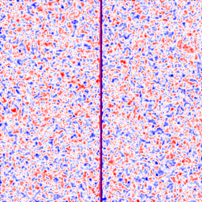 | 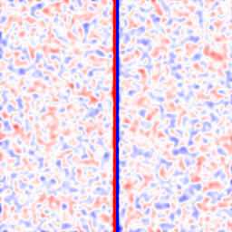 | 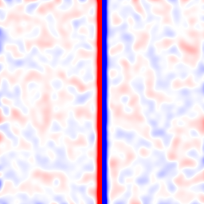 |
| `checkerboard` | 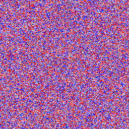 | 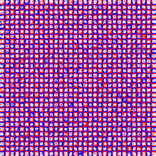 | 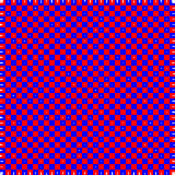 | 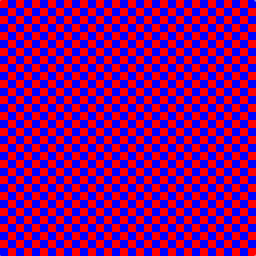 |

### Environment

CPU only: AMD Ryzen 9 9955HX3D, Windows 11, Python 3.13.5, NumPy 2.5.2, float64.

## Configuration

| Key | Example | Meaning |
|---|---|---|
| `seed` | `1234` | Base seed of the noise generator |
| `sizes` | `[[256, 256], [257, 129]]` | Image sizes $[W, H]$ |
| `patterns` | `{"checkerboard": {"cell": 8}}` | Patterns to generate and their parameters ($k$ = `cell`, $c$ = `value`, $f_{max}$ = `max_frequency`) |
| `noise.sigmas` | `[0.02, 0.05, 0.1, 0.2]` | Noise standard deviations $\sigma_n$ |
| `filters.no_filter` | `{}` | Include the unfiltered baseline |
| `filters.gaussian.sigmas` | `[0.5, 1.0, 2.0, 4.0]` | Blur standard deviations $\sigma$ |
| `filters.gaussian.truncate` | `3.0` | Kernel radius $R = \lceil \text{truncate} \cdot \sigma \rceil$ |
| `filters.gaussian.implementations` | `["direct", "separable"]` | Gaussian variants to run |
| `metrics.peak` | `1.0` | Peak value in PSNR |
| `output_dir` | `"results/default"` | Output folder, relative to this directory |
