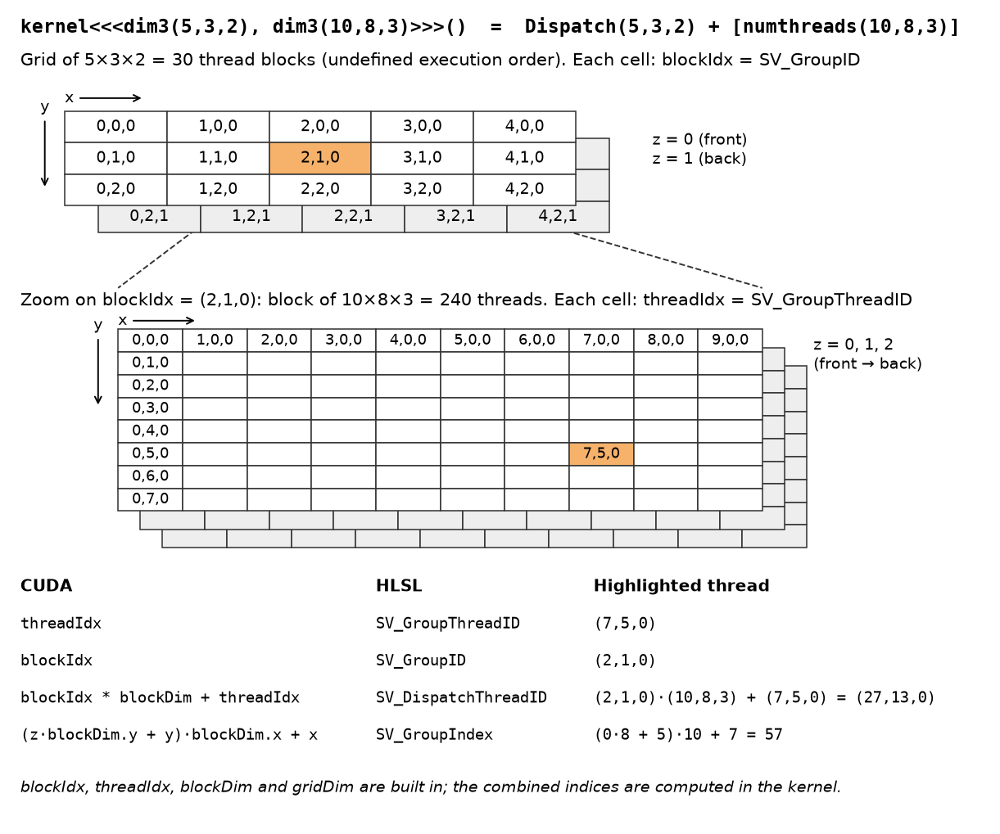
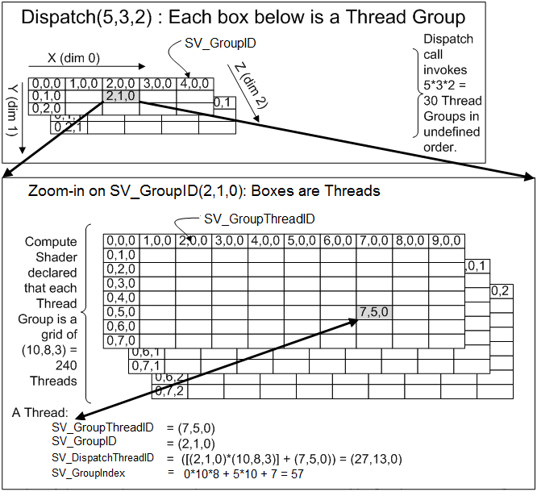
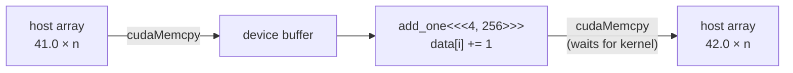
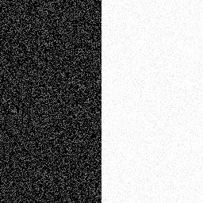
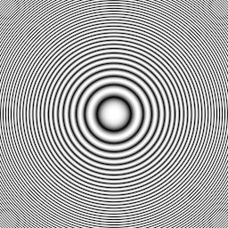
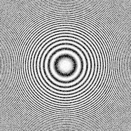
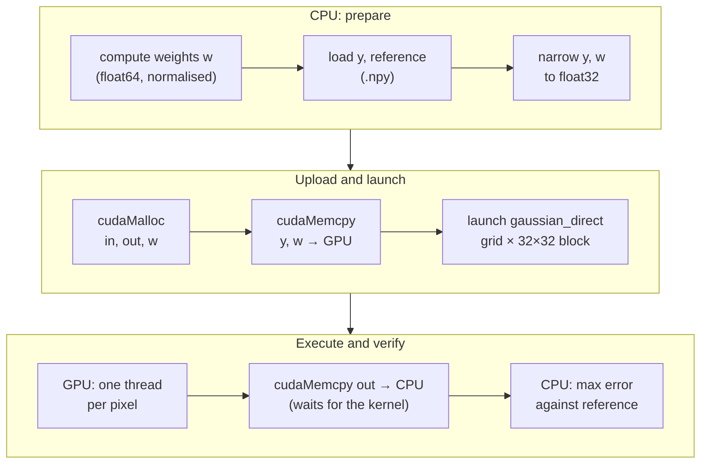
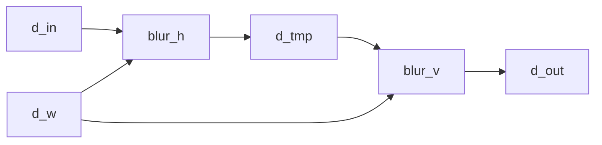
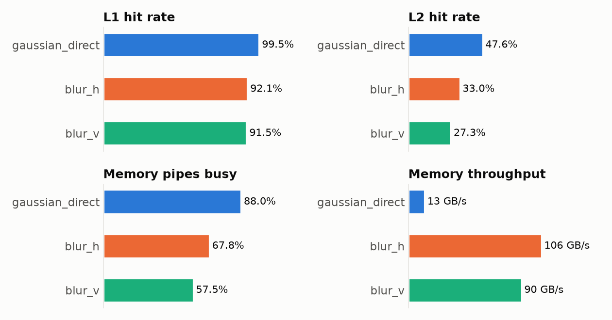
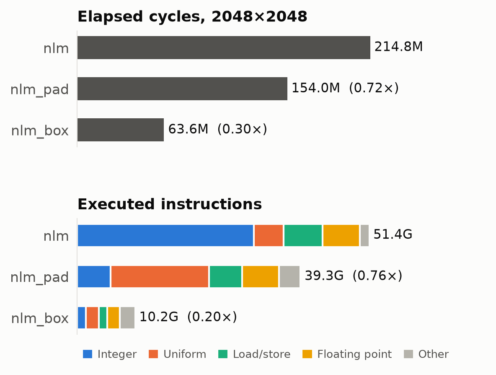

# 01 — CUDA filtering

**Track:** PC series (M1) · **Status:** Done

GPU implementation of image filters in CUDA, verified against a CPU float64 reference.

| Part | Content | Status |
|---|---|---|
| `HelloCuda` | Toolchain check: upload, kernel, readback | Done |
| `GaussianFilter` | Direct and separable 2D Gaussian: comparison with the float64 reference, timing, shared memory | Done |
| `NonLocalMeans` | Direct per-pixel non-local means: comparison with the float64 reference, timing; padded input and separable shared-memory versions | Done |

```bash
python ../00-image-baseline/run.py               # generates the float64 reference (.npy)
# then build and run CudaFiltering/CudaFiltering.sln (Visual Studio 2022, CUDA build customisation)
```

## Execution model

<a href="figures/cuda_indexing.png"></a>

Same model in HLSL:

<a href="figures/SV_DispatchThreadID.png"></a>

<sub>Figure: Microsoft, [SV_DispatchThreadID](https://learn.microsoft.com/en-us/windows/win32/direct3dhlsl/sv-dispatchthreadid), [CC BY 4.0](https://creativecommons.org/licenses/by/4.0/).</sub>

## DX12 / HLSL → CUDA

| DX12 / HLSL | CUDA |
|---|---|
| Compute shader entry point | `__global__ void kernel(...)` |
| `[numthreads(X,Y,Z)]` | Block size, chosen at launch |
| `Dispatch(X,Y,Z)` | `kernel<<<grid, block>>>(args)` |
| `SV_GroupID`, `SV_GroupThreadID` | `blockIdx`, `threadIdx` |
| `SV_DispatchThreadID` | `blockIdx * blockDim + threadIdx` |
| `CreateCommittedResource` | `cudaMalloc` |
| Descriptor, root signature, PSO | Raw pointer as kernel argument |
| Upload / readback heap + `CopyBufferRegion` | `cudaMemcpy` |
| `groupshared` | `__shared__` |
| `GroupMemoryBarrierWithGroupSync` | `__syncthreads()` |
| Fence wait | `cudaDeviceSynchronize`, blocking `cudaMemcpy` |
| `ExecuteCommandLists` (asynchronous) | Kernel launch (asynchronous) |
| D3D12 debug layer | `compute-sanitizer` (wraps the executable) |
| DXIL → driver → native ISA | PTX → driver or `nvcc` → SASS |

## HelloCuda



$$i = \text{blockIdx.x} \cdot \text{blockDim.x} + \text{threadIdx.x}, \qquad \text{grid} = \lceil n / \text{block} \rceil$$

Threads with $i \ge n$ exit without writing (the last block may extend past $n$).

### Correctness

Laptop GPU, $n = 1024$, block 256.

| Check | Result |
|---|---|
| `h[0]`, `h[n-1]` after readback | 42.0, 42.0 |
| `compute-sanitizer` | 0 errors |
| Injected out-of-bounds access ($n$ = 1024, 1000-element buffer) | Normal run: `cudaSuccess`. Sanitizer: invalid read at block 3, thread 232 ($i = 1000$) |

## GaussianFilter

Filter definition, boundary handling and test data: [00 — Image baseline](../00-image-baseline/README.md).

$$\hat{x}[v,u] = \sum_{j=-R}^{R}\sum_{i=-R}^{R} w_j w_i \cdot y\big[c_v(v+j), c_u(u+i)\big], \qquad R = \lceil 3\sigma \rceil$$

Inputs: noisy images ($\sigma_n = 0.1$), 256×256 and 257×129. Non-square size exposes swapped-axis errors.

| Pattern | Clean | Noisy | Exposes |
|---|---|---|---|
| `step_edge` |  |  | Kernel shift or asymmetry, border handling |
| `zone_plate` |  |  | Wrong weights, swapped axes (all frequencies, both axes) |

### Direct



Kernel, per thread:

```
(u, v) = blockIdx.xy * blockDim.xy + threadIdx.xy
if u >= W or v >= H: return
sum = 0
for j in [-R, R]:
    for i in [-R, R]:
        sum += w[j+R] * w[i+R] * in[clamp(v+j, 0, H-1) * W + clamp(u+i, 0, W-1)]
out[v * W + u] = sum
```

### Separable

Definition and cost: [00 — Filters](../00-image-baseline/README.md#filters). Inputs, upload and readback as for the direct filter, with one additional buffer `d_tmp`.



Kernels, per thread:

```
blur_h: out[v * W + u] = sum over i in [-R, R] of w[i+R] * in[v * W + clamp(u+i, 0, W-1)]
blur_v: out[v * W + u] = sum over j in [-R, R] of w[j+R] * in[clamp(v+j, 0, H-1) * W + u]
```

Both launches use the default stream, which executes in order: `blur_v` observes the writes of `blur_h` without an explicit barrier.

### Results

`max |CUDA (float32) − reference (float64)|`, laptop GPU, Release, 16 cases per filter.

| Filter | Pattern, size | $\sigma = 0.5$ | $\sigma = 1$ | $\sigma = 2$ | $\sigma = 4$ |
|---|---|---|---|---|---|
| Direct | Taps per pixel | 25 | 49 | 169 | 625 |
| | `step_edge`, 256×256 | 4.80e-7 | 5.67e-7 | 1.03e-6 | 1.52e-6 |
| | `step_edge`, 257×129 | 4.67e-7 | 5.04e-7 | 8.50e-7 | 1.50e-6 |
| | `zone_plate`, 256×256 | 3.46e-7 | 4.33e-7 | 6.36e-7 | 1.19e-6 |
| | `zone_plate`, 257×129 | 3.05e-7 | 4.63e-7 | 6.21e-7 | 7.99e-7 |
| Separable | Taps per pixel | 10 | 14 | 26 | 50 |
| | `step_edge`, 256×256 | 2.77e-7 | 2.76e-7 | 2.91e-7 | 3.35e-7 |
| | `step_edge`, 257×129 | 2.91e-7 | 3.05e-7 | 2.66e-7 | 4.47e-7 |
| | `zone_plate`, 256×256 | 2.37e-7 | 2.11e-7 | 1.79e-7 | 2.39e-7 |
| | `zone_plate`, 257×129 | 2.11e-7 | 1.80e-7 | 1.68e-7 | 2.18e-7 |

Largest error of each column:

| Quantity | $\sigma = 0.5$ | $\sigma = 1$ | $\sigma = 2$ | $\sigma = 4$ |
|---|---|---|---|---|
| Direct | 4.80e-7 | 5.67e-7 | 1.03e-6 | 1.52e-6 |
| Separable | 2.91e-7 | 3.05e-7 | 2.91e-7 | 4.47e-7 |
| Error ratio, direct / separable | 1.6 | 1.9 | 3.5 | 3.4 |
| √(direct taps / separable taps) | 1.6 | 1.9 | 2.5 | 3.5 |
| `max abs(direct − separable)` | 5.96e-7 | 5.96e-7 | 1.07e-6 | 1.55e-6 |

### Discussion

| Observation | Interpretation |
|---|---|
| Maximum error 1.5e-6 (direct), 4.5e-7 (separable) | float32 rounding ($\varepsilon = 1.2 \times 10^{-7}$ at 1.0): both filters match the reference, including borders and the non-square size |
| Separable error is lower in all 16 cases | Each float32 operation rounds; separable performs fewer operations per pixel (50 terms with one multiplication each, against 625 with two, at $\sigma = 4$) |
| Direct error grows with $\sigma$ | More taps accumulate more rounding error |
| Error ratio follows √(tap ratio), except at $\sigma = 2$ | Consistent with rounding errors of random sign accumulating as a random walk |
| Separable error remains nearly constant with $\sigma$ | Not explained by the tap count. Attenuation of first-pass rounding by the second pass is a candidate; not verified |
| Direct and separable differ by up to 1.55e-6, against 3.1e-15 in float64 | Identical in exact arithmetic; the difference is float32 rounding, dominated by the direct filter |
| Debug and Release differ in the last digits (e.g. 5.38e-7 and 4.80e-7) | Compiled floating-point operations differ; the error magnitude does not |

The separable form requires fewer taps and, in float32, is the more precise evaluation.

### Timing

Input: constant 0.5 image, 256×256 and 2048×2048. Kernel cost depends on $W$, $H$ and $R$ only, since the kernels contain no data-dependent branches.

| Measure | Clock | Interval |
|---|---|---|
| CPU wait | `std::chrono::steady_clock` | Launch until `cudaDeviceSynchronize` returns |
| GPU time | CUDA events | Between events recorded before and after the kernel |
| Transfer | `std::chrono::steady_clock` | `cudaMemcpy`, one measurement per image size and $\sigma$ |

```
first = time(launch, sync)                     # reported alone
repeat 10:  launch, sync                       # warm-up, discarded
repeat 100: time(launch, sync)                 # CPU wait
repeat 100: event, launch, event, sync         # GPU time
report the median of each series
```

Steady-state medians in ms, one run, laptop GPU, Release.

CPU wait. Speed-up is direct / separable.

| Size | $\sigma$ | Direct | Separable | Speed-up | Tap ratio |
|---|---|---|---|---|---|
| 256×256 | 0.5 | 0.009 | 0.013 | 0.7 | 2.5 |
| 256×256 | 1 | 0.011 | 0.013 | 0.8 | 3.5 |
| 256×256 | 2 | 0.017 | 0.013 | 1.3 | 6.5 |
| 256×256 | 4 | 0.041 | 0.015 | 2.7 | 12.5 |
| 2048×2048 | 0.5 | 0.116 | 0.084 | 1.4 | 2.5 |
| 2048×2048 | 1 | 0.200 | 0.100 | 2.0 | 3.5 |
| 2048×2048 | 2 | 0.544 | 0.140 | 3.9 | 6.5 |
| 2048×2048 | 4 | 1.875 | 0.220 | 8.5 | 12.5 |

GPU time.

| Size | $\sigma$ | Direct | Separable | `blur_h` | `blur_v` |
|---|---|---|---|---|---|
| 256×256 | 0.5 | 0.010 | 0.017 | 0.009 | 0.008 |
| 256×256 | 1 | 0.012 | 0.020 | 0.009 | 0.008 |
| 256×256 | 2 | 0.018 | 0.018 | 0.010 | 0.007 |
| 256×256 | 4 | 0.040 | 0.017 | 0.010 | 0.007 |
| 2048×2048 | 0.5 | 0.118 | 0.086 | 0.046 | 0.040 |
| 2048×2048 | 1 | 0.206 | 0.101 | 0.051 | 0.050 |
| 2048×2048 | 2 | 0.542 | 0.140 | 0.072 | 0.069 |
| 2048×2048 | 4 | 1.872 | 0.224 | 0.115 | 0.108 |

Startup and transfers, in ms.

| Quantity | 256×256 | 2048×2048 |
|---|---|---|
| First launch, direct | 0.174 | not isolated |
| First launch, separable | 0.092 | not isolated |
| Upload | 0.26 to 0.38 | 1.8 to 2.4 |
| Readback | 0.07 to 0.10 | 1.3 to 1.7 |

Fixed cost per launch, GPU time. Separate test, not part of the solution: median of 200 runs, same grid and block size.

| Kernel | 256×256 | 2048×2048 |
|---|---|---|
| Empty | 0.008 | 0.015 |
| Per-pixel copy, no filtering | 0.008 | 0.028 |

$$t \approx k \cdot t_0 + c \cdot n$$

$k$: launches (direct 1, separable 2). $t_0$: fixed cost per launch. $c$: cost per tap. $n$: taps per pixel.

| Observation | Interpretation |
|---|---|
| At 256×256, separable is slower up to $\sigma = 1$ and faster from $\sigma = 2$ | $k \cdot t_0$ dominates small workloads, and separable pays it twice |
| At 2048×2048, separable is faster at every $\sigma$ | $c \cdot n$ dominates |
| Speed-up stays below the tap ratio (8.5 against 12.5) | Same fixed cost; separable also performs one additional image write |
| CPU wait and GPU time agree to 0.006 ms at 2048×2048 | CPU-side launch and synchronisation overhead is small at this size |
| At 256×256, separable GPU time exceeds CPU wait | Probably the cost of the additional event between passes; not verified |
| `blur_v` is not slower than `blur_h` | Row-crossing reads carry no visible penalty at these sizes; see [Nsight Compute](#nsight-compute) |
| Transfers exceed the separable filter time at 2048×2048 | Per-frame readback would dominate this workload |

### Block size

CPU wait, medians in ms, 2048×2048, one run, laptop GPU, Release. The 32×32 block runs first and last as a control against ordering effects.

| Block | Separable $\sigma = 0.5$ | $\sigma = 1$ | $\sigma = 2$ | $\sigma = 4$ | Direct $\sigma = 0.5$ | $\sigma = 1$ | $\sigma = 2$ | $\sigma = 4$ |
|---|---|---|---|---|---|---|---|---|
| 32×32, first | 0.084 | 0.102 | 0.148 | 0.227 | 0.117 | 0.203 | 0.554 | 1.943 |
| 32×16 | 0.076 | 0.094 | 0.131 | 0.185 | 0.118 | 0.216 | 0.693 | 2.011 |
| 16×16 | 0.066 | 0.076 | 0.111 | 0.201 | 0.108 | 0.182 | 0.543 | 2.099 |
| 32×8 | 0.064 | 0.073 | 0.108 | 0.185 | 0.107 | 0.178 | 0.533 | 1.931 |
| 64×8 | 0.071 | 0.075 | 0.113 | 0.181 | 0.111 | 0.184 | 0.546 | 1.929 |
| 128×4 | 0.068 | 0.082 | 0.120 | 0.185 | 0.111 | 0.179 | 0.545 | 1.984 |
| 32×32, last | 0.095 | 0.101 | 0.157 | 0.231 | 0.128 | 0.204 | 0.563 | 1.984 |

Filter errors at every block size match the 32×32 results to all printed digits.

| Observation | Interpretation |
|---|---|
| The control reproduces its first result or is slower | The gain is not an ordering effect |
| 32×8 reduces separable time by 19 to 28% | Smaller blocks suit the separable passes; cause not established |
| Direct gains 9 to 12% at $\sigma \le 1$, and little at $\sigma \ge 2$ | Consistent with load issue rate limiting the direct filter |
| 32×16 slows direct at $\sigma = 2$ by 14 to 27% | Present in all three runs, with varying size; cause not established |

### Shared memory

`blur_h_shared` and `blur_v_shared` read the weights from block-local storage. The image is still read from device memory.

```
shared sw[2R+1]                                # one copy per block, undefined at block start
t = threadIdx.y * blockDim.x + threadIdx.x
if t < 2R+1: sw[t] = w[t]                      # one thread per weight
barrier                                        # all threads of the block, including those outside the image
if u >= W or v >= H: return
sum over taps, with sw[...] in place of w[...]
```

Requirement: block size $\ge 2R + 1$ threads. All tested blocks satisfy it, with $2R + 1 \le 25$.

Change in CPU wait, shared against plain separable within the same block and $\sigma$. 2048×2048, medians, one run, laptop GPU, Release.

| Block | $\sigma = 0.5$ | $\sigma = 1$ | $\sigma = 2$ | $\sigma = 4$ |
|---|---|---|---|---|
| Weight reads per pixel, per pass | 5 | 7 | 13 | 25 |
| 32×32, first | +1% | +8% | −13% | −17% |
| 32×16 | +20% | +13% | +3% | −16% |
| 16×16 | +11% | +11% | −1% | −18% |
| 32×8 | +10% | +11% | −2% | −18% |
| 64×8 | +11% | +7% | +1% | −14% |
| 128×4 | +11% | +8% | +1% | −15% |
| 32×32, last | +1% | +3% | −9% | −16% |

| Check | Result |
|---|---|
| `max abs(shared − separable)`, 16 cases at each of 7 blocks | 0 |
| `compute-sanitizer`, separate test: 257×129 and 2048², 3 blocks, 3 values of $\sigma$ | 0 errors |

| Observation | Interpretation |
|---|---|
| Shared is 14 to 18% faster at $\sigma = 4$ and up to 20% slower at $\sigma \le 1$ | Weight load and barrier are a cost per block; the saving scales with weight reads per pixel. Not profiled |
| The 32×32 control is slower at the end of the run (separable +61%, direct +66% at $\sigma = 4$) | GPU clock change is a candidate; clocks were not logged. Times in this run are compared only within one block and $\sigma$ |

## Profiling

Launch settings for Nsight Systems and Nsight Compute, with `<repo>` as the absolute repository path:

| Field | Value |
|---|---|
| Command line | `"<repo>\experiments\pc\01-cuda-filtering\CudaFiltering\x64\Release\GaussianFilter.exe"` |
| Working directory | `<repo>\experiments\pc\01-cuda-filtering\CudaFiltering\GaussianFilter` |

The working directory is required: `GaussianFilter` resolves the `.npy` root relative to it.

### Nsight Systems

Laptop GPU, Release, kernels and API calls traced.

| 256×256, median | Time |
|---|---|
| `blur_h`, kernel execution | 1.4 µs |
| `blur_v`, kernel execution | 1.5 µs |
| One pass, GPU time from events | 8 to 9 µs |
| `cudaLaunchKernel`, CPU call under tracing | 6 to 8 µs |

Most of the fixed cost lies outside kernel execution. Idle GPU time during the CPU launch call is a candidate cause; not verified.

### Nsight Compute

Profile activity, metric set `full`, one kernel per report. Launch skip 1489 and launch count 1 select a warmed launch at 2048×2048, $\sigma = 4$.

Durations are not comparable with the Timing section: the profiler reported an SM clock of 1.55 to 1.59 GHz.



Counter checks, with $2048^2 / 32 = 131072$ warps: `gaussian_direct` fused FP32 instructions = 625 × 131072; `blur_v` loads = 50 × 131072 (25 image, 25 weights), stores = 131072.

| Observation | Interpretation |
|---|---|
| `gaussian_direct`: L1 hit rate 99.5%, memory pipes 88% busy | Limited by load issue rate, not by cache misses |
| LG throttle is the largest stall and LSU the busiest pipe | Load and store issue, not arithmetic, limits throughput |
| `blur_v`: 6.67 active warps per scheduler, 1.67 eligible | Most warps are waiting |
| `blur_v` is 17.6% slower than `blur_h` under the profiler, but not in the Timing section | L2 hit rate 27% against 33%, with about one full image read from device memory. In the application the input is probably already in L2; not verified |
| Half of the `blur_v` loads read weights | The weights contribute to load pressure |
| Theoretical occupancy is 66.7% (8 of 12 warps) for all three kernels | Limited by registers and warps per block; the 32×32 block occupies 32 warps |

## NonLocalMeans

Definition, parameters and quality comparison: [00 — Non-local means](../00-image-baseline/README.md#non-local-means). `nlm` is the base version: every read goes to device memory, with no shared memory or separable patch distance. Faster versions: [NLM optimizations](#nlm-optimizations).

```
for each offset (dj, di) in [-S, S]²:
    d2 = mean over patch of (in[p + k] - in[p + (dj, di) + k])²
    w  = exp(-max(d2 - 2σn², 0) / h²)
    sum += w * in[p + (dj, di)];  total += w
out[p] = sum / total
```

$S = 10$, $P = 3$, $h = 0.14$: 43,659 image reads per pixel. Block 32×32, laptop GPU, Release.

| Check, against float64 reference | Result |
|---|---|
| Maximum error, 4 cases (`step_edge`, `zone_plate`; 256×256, 257×129) | 3.55e-6 |
| `compute-sanitizer`, separate test with the same kernel | 0 errors |

CPU wait in ms, 11 runs after 3 warm-up launches, noisy input (the weights depend on the data).

| Size | Median | Min | Max |
|---|---|---|---|
| 256×256 | 1.85 | 1.60 | 2.19 |
| 2048×2048 | 93.98 | 89.84 | 114.41 |

Block sizes are not compared here: in a separate run, SM clock samples ranged from 1.4 to 2.4 GHz under a software power cap, and the ordering of 32×32 and 32×8 changed between runs.

## NLM optimizations

Two changes to the base kernel, with the same definition and parameters. Cycles at 2048×2048, in millions, and instructions, in billions:



### Padded input

`nlm_pad` reads a copy of the image with a clamped border, so no read requires a clamp.

```
R   = S + P
pad = image + border of width R, filled by clamping (host, once)
p   = pad + (v + R) * stride + (u + R)
q   = p + dj * stride + di
e   = p[k] - q[k]
```

### Separable patch distance in shared memory

`nlm_box` applies the patch distance as a box filter per offset $d$, with $T = 2P + 1$:

$$d_d^2[p] = \frac{1}{T^2} \sum_{k_y} \sum_{k_x} \big(y[p + k] - y[p + k + d]\big)^2$$

Each thread holds `sum` and `total` in registers. Row sums stay in `__shared__`: $B (B + 2P)$ floats for block size $B$, 1.5 KB at $B = 32$.

```
for each offset d:
    tmp[row] = sum over kx of (pad[row + kx] - pad[row + kx + d])²
    __syncthreads()
    d2   = sum over ky of tmp[row + ky] / T²
    w    = exp(-max(d2 - 2σn², 0) / h²)
    sum += w * pad[p + d];  total += w
    __syncthreads()
out[p] = sum / total
```

| `__shared__` row | Written by |
|---|---|
| Rows of the block | The thread of that row |
| $P$ rows above | Threads of the first $P$ rows |
| $P$ rows below | Threads of the last $P$ rows |

All threads run every barrier, including threads outside the image; those threads skip the reads and the output. Each offset requires two barriers: readers must see all rows, and the next offset must not overwrite rows in use.

### Results

| Check | Result |
|---|---|
| `nlm_pad`, maximum absolute difference from `nlm`, 2048×2048 | 0 |
| `nlm_box`, maximum absolute difference from `nlm_pad`, 2048×2048 | 8.34e-7 |
| `nlm_box`, maximum error against the float64 reference, 4 cases, separate test | 3.55e-6 |
| `compute-sanitizer`, memory check, separate test, both kernels | 0 errors |
| `compute-sanitizer --tool racecheck`, `nlm_box`, separate test | 0 hazards |

Paired launches at 2048×2048, 11 pairs after 3 warm-up pairs, CPU wait. Each pair runs back to back, so clock drift affects both kernels nearly equally.

| Ratio | Median | Min | Max |
|---|---|---|---|
| `nlm_pad` / `nlm` | 0.714 | 0.681 | 0.744 |
| `nlm_box` / `nlm_pad` | 0.397 | 0.230 | 0.414 |

Nsight Compute, metric set `full`, `NonLocalMeans.exe`, `NonLocalMeans` working directory, one warmed launch per kernel. Launch skip 46 and count 2 select `nlm` and `nlm_pad`; skip 72 and count 2 select `nlm_pad` and `nlm_box`. `nlm_pad` values are from the second capture; the first gave 156.3M cycles and the same instruction count. Values marked ≈ are read from the report chart.

| 2048×2048 | `nlm` | `nlm_pad` | `nlm_box` |
|---|---|---|---|
| Image reads per pixel | 43,659 | 43,659 | 7,773 |
| Elapsed cycles | 214.8M | 154.0M | 63.6M |
| Executed instructions | 51.4G | 39.3G | 10.2G |
| Integer | ≈31G | ≈5.9G | ≈1.5G |
| Uniform datapath | ≈5.2G | ≈17.3G | ≈2.3G |
| Load/store | ≈6.9G | ≈5.8G | ≈1.5G |
| Fused + non-fused FP32 | 6.24G | 6.24G | 1.95G |
| Compute throughput | 80.5% | 90.8% | 57.3% |
| Memory throughput | 65.1% | 90.8% | 57.3% |
| L1/TEX hit rate | 99.99% | 99.99% | 99.95% |
| SM frequency | 1.42 GHz | 1.30 GHz | 1.18 GHz |

| Observation | Interpretation |
|---|---|
| Cycle ratios of 0.72 and 0.41 agree with the paired ratios | Durations are not compared, as the SM frequency differs between launches |
| `nlm_pad`: integer falls, uniform datapath rises | Per-tap clamps are removed, and loop counters and offsets no longer depend on the thread, so they can be computed once per warp. Not confirmed at source level |
| `nlm` and `nlm_pad`: 2.83G FMA, 2.83G subtractions, LSU ≈5.7G | One FMA and one subtraction per tap and 43,659 reads per pixel, over 131,072 warps |
| L1/TEX reports 26.3 of 32 bytes used per sector | A warp reads 32 floats at an unaligned offset, about 4.9 sectors on average; determined by the search offsets |
| `nlm_pad`: compute and memory both at 90.8% | Load issue limits the kernel together with compute |
| `nlm_box`: L1/TEX hit rate stays at 99.95% | Row sums and accumulators no longer reach global memory |
| `nlm_box`: throughput 57.3%, warp cycles per instruction 15.75 against 9.85 | Latency now dominates. Waiting at 882 barriers per block is a candidate cause; not separated |
| `nlm_box` / `nlm_pad` at 256×256: 0.334, separate test | No launch per offset, so the gain holds at small sizes |

## Environment

NVIDIA GeForce RTX 5090 Laptop GPU (compute capability 12.0, `sm_120`), driver 617.14 (621.01 for [NLM optimizations](#nlm-optimizations)), CUDA 13.4, Visual Studio 2022, Windows 11.
