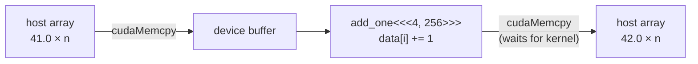
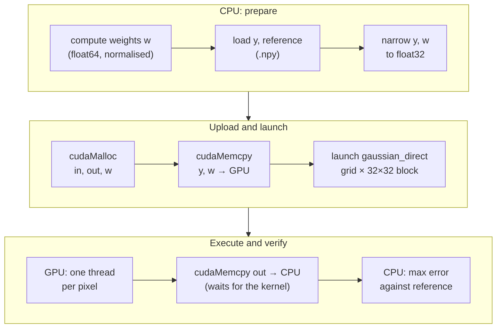
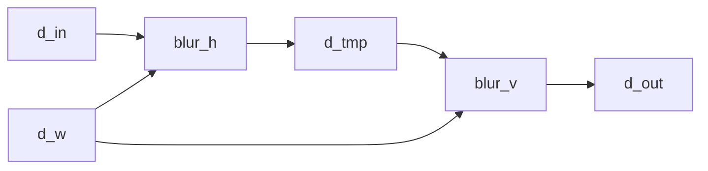

# 01 — CUDA filtering

**Track:** PC series (M1) · **Status:** In progress

GPU implementation of image filters in CUDA, verified against a CPU float64 reference.

| Part | Content | Status |
|---|---|---|
| `HelloCuda` | Toolchain check: upload, kernel, readback | Done |
| `GaussianFilter` | Direct and separable 2D Gaussian: comparison with the float64 reference, timing | Done |

```bash
python ../00-image-baseline/run.py               # generates the float64 reference (.npy)
# then build and run CudaFiltering/CudaFiltering.sln (Visual Studio 2022, CUDA build customisation)
```

## Execution model

<a href="figures/cuda_indexing.png"></a>

Same model in HLSL:

<a href="figures/SV_DispatchThreadID.png"></a>

<sub>Figure: Microsoft, [SV_DispatchThreadID](https://learn.microsoft.com/en-us/windows/win32/direct3dhlsl/sv-dispatchthreadid), [CC BY 4.0](https://creativecommons.org/licenses/by/4.0/).</sub>

## DX12 / HLSL → CUDA

| DX12 / HLSL | CUDA |
|---|---|
| Compute shader entry point | `__global__ void kernel(...)` |
| `[numthreads(X,Y,Z)]` | Block size, chosen at launch |
| `Dispatch(X,Y,Z)` | `kernel<<<grid, block>>>(args)` |
| `SV_GroupID`, `SV_GroupThreadID` | `blockIdx`, `threadIdx` |
| `SV_DispatchThreadID` | `blockIdx * blockDim + threadIdx` |
| `CreateCommittedResource` | `cudaMalloc` |
| Descriptor, root signature, PSO | Raw pointer as kernel argument |
| Upload / readback heap + `CopyBufferRegion` | `cudaMemcpy` |
| `groupshared` | `__shared__` |
| Fence wait | `cudaDeviceSynchronize`, blocking `cudaMemcpy` |
| `ExecuteCommandLists` (asynchronous) | Kernel launch (asynchronous) |
| D3D12 debug layer | `compute-sanitizer` (wraps the executable) |
| DXIL → driver → native ISA | PTX → driver or `nvcc` → SASS |

## HelloCuda



$$i = \text{blockIdx.x} \cdot \text{blockDim.x} + \text{threadIdx.x}, \qquad \text{grid} = \lceil n / \text{block} \rceil$$

Threads with $i \ge n$ exit without writing (the last block may extend past $n$).

### Correctness

Laptop GPU, $n = 1024$, block 256.

| Check | Result |
|---|---|
| `h[0]`, `h[n-1]` after readback | 42.0, 42.0 |
| `compute-sanitizer` | 0 errors |
| Injected out-of-bounds access ($n$ = 1024, 1000-element buffer) | Normal run: `cudaSuccess`. Sanitizer: invalid read at block 3, thread 232 ($i = 1000$) |

## GaussianFilter

Filter definition, boundary handling and test data: [00 — Image baseline](../00-image-baseline/README.md).

$$\hat{x}[v,u] = \sum_{j=-R}^{R}\sum_{i=-R}^{R} w_j w_i \cdot y\big[c_v(v+j), c_u(u+i)\big], \qquad R = \lceil 3\sigma \rceil$$

Inputs: noisy images ($\sigma_n = 0.1$), 256×256 and 257×129. Non-square size exposes swapped-axis errors.

| Pattern | Clean | Noisy | Exposes |
|---|---|---|---|
| `step_edge` |  |  | Kernel shift or asymmetry, border handling |
| `zone_plate` |  |  | Wrong weights, swapped axes (all frequencies, both axes) |

### Direct



Kernel, per thread:

```
(u, v) = blockIdx.xy * blockDim.xy + threadIdx.xy
if u >= W or v >= H: return
sum = 0
for j in [-R, R]:
    for i in [-R, R]:
        sum += w[j+R] * w[i+R] * in[clamp(v+j, 0, H-1) * W + clamp(u+i, 0, W-1)]
out[v * W + u] = sum
```

### Separable

Definition and cost: [00 — Filters](../00-image-baseline/README.md#filters). Inputs, upload and readback as for the direct filter, with one additional buffer `d_tmp`.



Kernels, per thread:

```
blur_h: out[v * W + u] = sum over i in [-R, R] of w[i+R] * in[v * W + clamp(u+i, 0, W-1)]
blur_v: out[v * W + u] = sum over j in [-R, R] of w[j+R] * in[clamp(v+j, 0, H-1) * W + u]
```

Both launches use the default stream, which executes in order: `blur_v` observes the writes of `blur_h` without an explicit barrier.

### Results

`max |CUDA (float32) − reference (float64)|`, laptop GPU, Release, 16 cases per filter.

| Filter | Pattern, size | $\sigma = 0.5$ | $\sigma = 1$ | $\sigma = 2$ | $\sigma = 4$ |
|---|---|---|---|---|---|
| Direct | Taps per pixel | 25 | 49 | 169 | 625 |
| | `step_edge`, 256×256 | 4.80e-7 | 5.67e-7 | 1.03e-6 | 1.52e-6 |
| | `step_edge`, 257×129 | 4.67e-7 | 5.04e-7 | 8.50e-7 | 1.50e-6 |
| | `zone_plate`, 256×256 | 3.46e-7 | 4.33e-7 | 6.36e-7 | 1.19e-6 |
| | `zone_plate`, 257×129 | 3.05e-7 | 4.63e-7 | 6.21e-7 | 7.99e-7 |
| Separable | Taps per pixel | 10 | 14 | 26 | 50 |
| | `step_edge`, 256×256 | 2.77e-7 | 2.76e-7 | 2.91e-7 | 3.35e-7 |
| | `step_edge`, 257×129 | 2.91e-7 | 3.05e-7 | 2.66e-7 | 4.47e-7 |
| | `zone_plate`, 256×256 | 2.37e-7 | 2.11e-7 | 1.79e-7 | 2.39e-7 |
| | `zone_plate`, 257×129 | 2.11e-7 | 1.80e-7 | 1.68e-7 | 2.18e-7 |

Largest error of each column:

| Quantity | $\sigma = 0.5$ | $\sigma = 1$ | $\sigma = 2$ | $\sigma = 4$ |
|---|---|---|---|---|
| Direct | 4.80e-7 | 5.67e-7 | 1.03e-6 | 1.52e-6 |
| Separable | 2.91e-7 | 3.05e-7 | 2.91e-7 | 4.47e-7 |
| Error ratio, direct / separable | 1.6 | 1.9 | 3.5 | 3.4 |
| √(direct taps / separable taps) | 1.6 | 1.9 | 2.5 | 3.5 |
| `max \|direct − separable\|` | 5.96e-7 | 5.96e-7 | 1.07e-6 | 1.55e-6 |

### Discussion

| Observation | Interpretation |
|---|---|
| Maximum error 1.5e-6 (direct), 4.5e-7 (separable) | float32 rounding ($\varepsilon = 1.2 \times 10^{-7}$ at 1.0): both filters match the reference, including borders and the non-square size |
| Separable error is lower in all 16 cases | Each float32 operation rounds; separable performs fewer operations per pixel (50 terms with one multiplication each, against 625 with two, at $\sigma = 4$) |
| Direct error grows with $\sigma$ | More taps accumulate more rounding error |
| Error ratio follows √(tap ratio), except at $\sigma = 2$ | Consistent with rounding errors of random sign accumulating as a random walk |
| Separable error remains nearly constant with $\sigma$ | Not explained by the tap count. Attenuation of first-pass rounding by the second pass is a candidate; not verified |
| Direct and separable differ by up to 1.55e-6, against 3.1e-15 in float64 | Identical in exact arithmetic; the difference is float32 rounding, dominated by the direct filter |
| Debug and Release differ in the last digits (e.g. 5.38e-7 and 4.80e-7) | Compiled floating-point operations differ; the error magnitude does not |

The separable form requires fewer taps and, in float32, is the more precise evaluation.

### Timing

Input: constant 0.5 image, 256×256 and 2048×2048. Kernel cost depends on $W$, $H$ and $R$ only, since the kernels contain no data-dependent branches.

| Measure | Clock | Interval |
|---|---|---|
| CPU wait | `std::chrono::steady_clock` | Launch until `cudaDeviceSynchronize` returns |
| GPU time | CUDA events | Between events recorded before and after the kernel |
| Transfer | `std::chrono::steady_clock` | `cudaMemcpy`, one measurement per image size and $\sigma$ |

```
first = time(launch, sync)                     # reported alone
repeat 10:  launch, sync                       # warm-up, discarded
repeat 100: time(launch, sync)                 # CPU wait
repeat 100: event, launch, event, sync         # GPU time
report the median of each series
```

Steady-state medians in ms, one run, laptop GPU, Release.

CPU wait. Speed-up is direct / separable.

| Size | $\sigma$ | Direct | Separable | Speed-up | Tap ratio |
|---|---|---|---|---|---|
| 256×256 | 0.5 | 0.009 | 0.013 | 0.7 | 2.5 |
| 256×256 | 1 | 0.011 | 0.013 | 0.8 | 3.5 |
| 256×256 | 2 | 0.017 | 0.013 | 1.3 | 6.5 |
| 256×256 | 4 | 0.041 | 0.015 | 2.7 | 12.5 |
| 2048×2048 | 0.5 | 0.116 | 0.084 | 1.4 | 2.5 |
| 2048×2048 | 1 | 0.200 | 0.100 | 2.0 | 3.5 |
| 2048×2048 | 2 | 0.544 | 0.140 | 3.9 | 6.5 |
| 2048×2048 | 4 | 1.875 | 0.220 | 8.5 | 12.5 |

GPU time.

| Size | $\sigma$ | Direct | Separable | `blur_h` | `blur_v` |
|---|---|---|---|---|---|
| 256×256 | 0.5 | 0.010 | 0.017 | 0.009 | 0.008 |
| 256×256 | 1 | 0.012 | 0.020 | 0.009 | 0.008 |
| 256×256 | 2 | 0.018 | 0.018 | 0.010 | 0.007 |
| 256×256 | 4 | 0.040 | 0.017 | 0.010 | 0.007 |
| 2048×2048 | 0.5 | 0.118 | 0.086 | 0.046 | 0.040 |
| 2048×2048 | 1 | 0.206 | 0.101 | 0.051 | 0.050 |
| 2048×2048 | 2 | 0.542 | 0.140 | 0.072 | 0.069 |
| 2048×2048 | 4 | 1.872 | 0.224 | 0.115 | 0.108 |

Startup and transfers, in ms.

| Quantity | 256×256 | 2048×2048 |
|---|---|---|
| First launch, direct | 0.174 | not isolated |
| First launch, separable | 0.092 | not isolated |
| Upload | 0.26 to 0.38 | 1.8 to 2.4 |
| Readback | 0.07 to 0.10 | 1.3 to 1.7 |

Fixed cost per launch, GPU time. Separate test, not part of the solution: median of 200 runs, same grid and block size.

| Kernel | 256×256 | 2048×2048 |
|---|---|---|
| Empty | 0.008 | 0.015 |
| Per-pixel copy, no filtering | 0.008 | 0.028 |

$$t \approx k \cdot t_0 + c \cdot n$$

$k$: launches (direct 1, separable 2). $t_0$: fixed cost per launch. $c$: cost per tap. $n$: taps per pixel.

| Observation | Interpretation |
|---|---|
| At 256×256, separable is slower up to $\sigma = 1$ and faster from $\sigma = 2$ | $k \cdot t_0$ dominates small workloads, and separable pays it twice |
| At 2048×2048, separable is faster at every $\sigma$ | $c \cdot n$ dominates |
| Speed-up stays below the tap ratio (8.5 against 12.5) | Same fixed cost; separable also performs one additional image write |
| CPU wait and GPU time agree to 0.006 ms at 2048×2048 | CPU-side launch and synchronisation overhead is small at this size |
| At 256×256, separable GPU time exceeds CPU wait | Probably the cost of the additional event between passes; not verified |
| `blur_v` is not slower than `blur_h` | Row-crossing reads carry no visible penalty at these sizes; cause not established |
| Transfers exceed the separable filter time at 2048×2048 | Per-frame readback would dominate this workload |

## Environment

NVIDIA GeForce RTX 5090 Laptop GPU (compute capability 12.0, `sm_120`), driver 617.14, CUDA 13.4, Visual Studio 2022, Windows 11.
