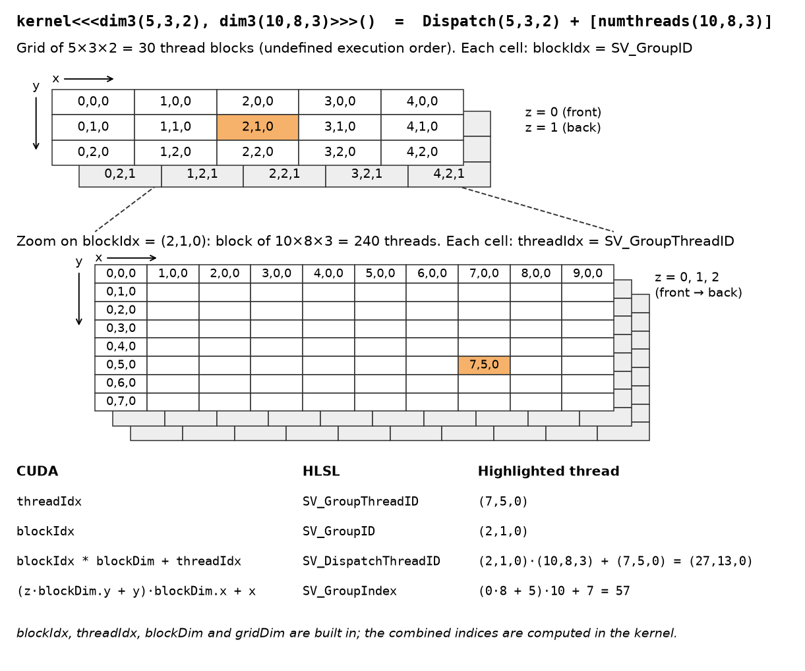
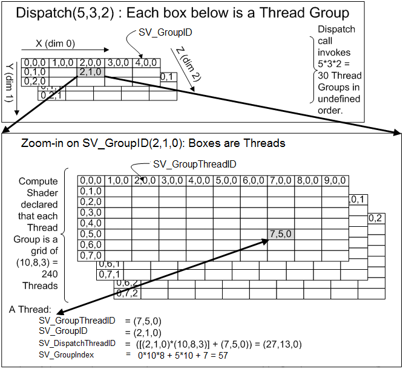
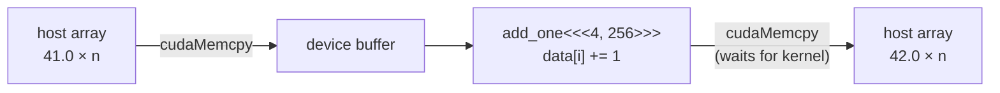

# 01 — CUDA filtering

**Track:** PC series (M1) · **Status:** In progress

GPU implementation of image filters in CUDA, verified against a CPU float64 reference.

| Part | Content | Status |
|---|---|---|
| `HelloCuda` | Toolchain check: upload, kernel, readback | Done |

```bash
# open CudaFiltering/CudaFiltering.sln (Visual Studio 2022, CUDA build customisation), or:
nvcc -arch=sm_120 CudaFiltering/HelloCuda/kernel.cu -o hello.exe
```

## Execution model

<a href="figures/cuda_indexing.png"></a>

Same model in HLSL:

<a href="figures/SV_DispatchThreadID.png"></a>

<sub>Figure: Microsoft, [SV_DispatchThreadID](https://learn.microsoft.com/en-us/windows/win32/direct3dhlsl/sv-dispatchthreadid), [CC BY 4.0](https://creativecommons.org/licenses/by/4.0/).</sub>

## DX12 / HLSL → CUDA

| DX12 / HLSL | CUDA |
|---|---|
| Compute shader entry point | `__global__ void kernel(...)` |
| `[numthreads(X,Y,Z)]` | Block size, chosen at launch |
| `Dispatch(X,Y,Z)` | `kernel<<<grid, block>>>(args)` |
| `SV_GroupID`, `SV_GroupThreadID` | `blockIdx`, `threadIdx` |
| `SV_DispatchThreadID` | `blockIdx * blockDim + threadIdx` |
| `CreateCommittedResource` | `cudaMalloc` |
| Descriptor, root signature, PSO | Raw pointer as kernel argument |
| Upload / readback heap + `CopyBufferRegion` | `cudaMemcpy` |
| `groupshared` | `__shared__` |
| Fence wait | `cudaDeviceSynchronize`, blocking `cudaMemcpy` |
| `ExecuteCommandLists` (asynchronous) | Kernel launch (asynchronous) |
| D3D12 debug layer | `compute-sanitizer` (wraps the executable) |
| DXIL → driver → native ISA | PTX → driver or `nvcc` → SASS |

## HelloCuda



$$i = \text{blockIdx.x} \cdot \text{blockDim.x} + \text{threadIdx.x}, \qquad \text{grid} = \lceil n / \text{block} \rceil$$

Threads with $i \ge n$ exit without writing (the last block may extend past $n$).

### Correctness

Laptop GPU, $n = 1024$, block 256.

| Check | Result |
|---|---|
| `h[0]`, `h[n-1]` after readback | 42.0, 42.0 |
| `compute-sanitizer` | 0 errors |
| Injected out-of-bounds access ($n$ = 1024, 1000-element buffer) | Normal run: `cudaSuccess`. Sanitizer: invalid read at block 3, thread 232 ($i = 1000$) |

## Environment

NVIDIA GeForce RTX 5090 Laptop GPU (compute capability 12.0), driver 617.14, CUDA 13.4, Visual Studio 2022, Windows 11.
