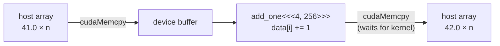
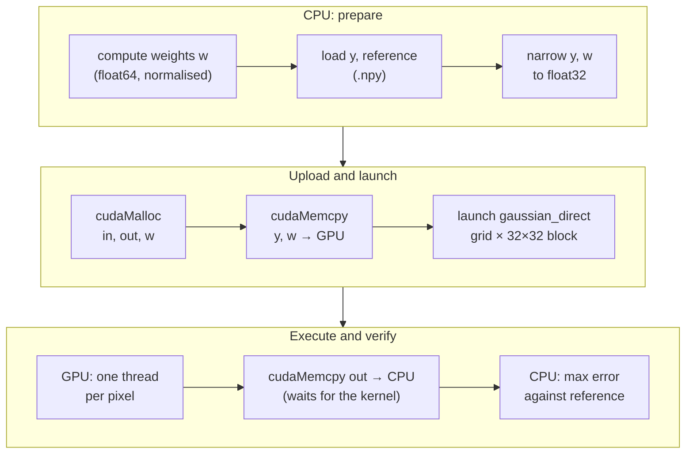

# 01 — CUDA filtering

**Track:** PC series (M1) · **Status:** In progress

GPU implementation of image filters in CUDA, verified against a CPU float64 reference.

| Part | Content | Status |
|---|---|---|
| `HelloCuda` | Toolchain check: upload, kernel, readback | Done |
| `GaussianFilter` | Direct 2D Gaussian, compared with the float64 reference | Done |

```bash
python ../00-image-baseline/run.py               # generates the float64 reference (.npy)
# then build and run CudaFiltering/CudaFiltering.sln (Visual Studio 2022, CUDA build customisation)
```

## Execution model

<a href="figures/cuda_indexing.png"></a>

Same model in HLSL:

<a href="figures/SV_DispatchThreadID.png"></a>

<sub>Figure: Microsoft, [SV_DispatchThreadID](https://learn.microsoft.com/en-us/windows/win32/direct3dhlsl/sv-dispatchthreadid), [CC BY 4.0](https://creativecommons.org/licenses/by/4.0/).</sub>

## DX12 / HLSL → CUDA

| DX12 / HLSL | CUDA |
|---|---|
| Compute shader entry point | `__global__ void kernel(...)` |
| `[numthreads(X,Y,Z)]` | Block size, chosen at launch |
| `Dispatch(X,Y,Z)` | `kernel<<<grid, block>>>(args)` |
| `SV_GroupID`, `SV_GroupThreadID` | `blockIdx`, `threadIdx` |
| `SV_DispatchThreadID` | `blockIdx * blockDim + threadIdx` |
| `CreateCommittedResource` | `cudaMalloc` |
| Descriptor, root signature, PSO | Raw pointer as kernel argument |
| Upload / readback heap + `CopyBufferRegion` | `cudaMemcpy` |
| `groupshared` | `__shared__` |
| Fence wait | `cudaDeviceSynchronize`, blocking `cudaMemcpy` |
| `ExecuteCommandLists` (asynchronous) | Kernel launch (asynchronous) |
| D3D12 debug layer | `compute-sanitizer` (wraps the executable) |
| DXIL → driver → native ISA | PTX → driver or `nvcc` → SASS |

## HelloCuda



$$i = \text{blockIdx.x} \cdot \text{blockDim.x} + \text{threadIdx.x}, \qquad \text{grid} = \lceil n / \text{block} \rceil$$

Threads with $i \ge n$ exit without writing (the last block may extend past $n$).

### Correctness

Laptop GPU, $n = 1024$, block 256.

| Check | Result |
|---|---|
| `h[0]`, `h[n-1]` after readback | 42.0, 42.0 |
| `compute-sanitizer` | 0 errors |
| Injected out-of-bounds access ($n$ = 1024, 1000-element buffer) | Normal run: `cudaSuccess`. Sanitizer: invalid read at block 3, thread 232 ($i = 1000$) |

## GaussianFilter

Filter definition, boundary handling and test data: [00 — Image baseline](../00-image-baseline/README.md).

$$\hat{x}[v,u] = \sum_{j=-R}^{R}\sum_{i=-R}^{R} w_j\, w_i\; y\big[c_v(v+j),\, c_u(u+i)\big], \qquad R = \lceil 3\sigma \rceil$$

Inputs: noisy images ($\sigma_n = 0.1$), 256×256 and 257×129. Non-square size exposes swapped-axis errors.

| Pattern | Clean | Noisy | Exposes |
|---|---|---|---|
| `step_edge` |  |  | Kernel shift or asymmetry, border handling |
| `zone_plate` |  |  | Wrong weights, swapped axes (all frequencies, both axes) |

### Pipeline



Kernel, per thread:

```
(u, v) = blockIdx.xy * blockDim.xy + threadIdx.xy
if u >= W or v >= H: return
sum = 0
for j in [-R, R]:
    for i in [-R, R]:
        sum += w[j+R] * w[i+R] * in[clamp(v+j, 0, H-1) * W + clamp(u+i, 0, W-1)]
out[v * W + u] = sum
```

### Results

$\max|\hat{x}_{\text{CUDA, float32}} - \hat{x}_{\text{reference, float64}}|$, laptop GPU, Release, 16 cases.

| Pattern, size | $\sigma = 0.5$ | $\sigma = 1$ | $\sigma = 2$ | $\sigma = 4$ |
|---|---|---|---|---|
| Taps per pixel | 25 | 49 | 169 | 625 |
| `step_edge`, 256×256 | 4.80e-7 | 5.67e-7 | 1.03e-6 | 1.52e-6 |
| `step_edge`, 257×129 | 4.67e-7 | 5.04e-7 | 8.50e-7 | 1.50e-6 |
| `zone_plate`, 256×256 | 3.46e-7 | 4.33e-7 | 6.36e-7 | 1.19e-6 |
| `zone_plate`, 257×129 | 3.05e-7 | 4.64e-7 | 6.21e-7 | 7.99e-7 |

### Discussion

| Observation | Interpretation |
|---|---|
| Maximum error $1.5 \times 10^{-6}$ | float32 rounding ($\varepsilon = 1.2 \times 10^{-7}$ at 1.0): the kernel matches the reference, including borders and the non-square size |
| Error grows with $\sigma$ | More taps accumulate more rounding error |
| Debug and Release differ in the last digits (e.g. 5.38e-7 and 4.80e-7) | Compiled floating-point operations differ; the error magnitude does not |

Cost grows with $(2R+1)^2$ taps per pixel. Timing is not yet measured.

## Environment

NVIDIA GeForce RTX 5090 Laptop GPU (compute capability 12.0, `sm_120`), driver 617.14, CUDA 13.4, Visual Studio 2022, Windows 11.
