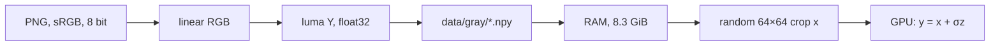
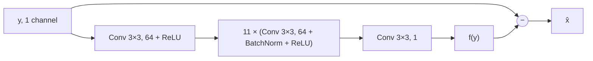

# 02 — Neural denoising

**Track:** PC series (M2) · **Status:** In progress

A compact residual CNN, trained in PyTorch on natural photographs with synthetic Gaussian noise, for comparison with the classical filters of 00 and 01.

| Part | Content | Status |
|---|---|---|
| `prepare.py` | DIV2K PNG to linear one-channel `.npy` | Done |
| `dataset.py` | Random clean patches, noise added on the GPU | Done |
| `model.py` | DnCNN-style residual denoiser | Done |
| `train.py`, `plot.py` | Training loop, validation curve | Done |
| Evaluation | Comparison with noisy input, Gaussian and NLM on held-out images | Pending |
| Inference | Model size, inference time, failure cases | Pending |
| CUDA inference | Hand-written CUDA forward pass, compared with PyTorch | Pending |

```bash
python -m venv .venv                 # then activate .venv
pip install torch --index-url https://download.pytorch.org/whl/cu134
pip install numpy matplotlib pillow pytest
python prepare.py                    # once, after downloading DIV2K into data/
python -m pytest                     # correctness tests; DIV2K tests skip without data/gray/
python train.py                      # writes runs/depth13/: config.json, curve.csv, model.pt
python plot.py                       # writes runs/depth13/curve.png
```

## Problem

Same noise model as [00](../00-image-baseline/README.md): one linear channel, additive Gaussian noise, no clipping.

$$y = x + \sigma z, \qquad z \sim \mathcal{N}(0, 1), \qquad \sigma = 0.1$$

$$\mathrm{MSE} = \frac{1}{N} \sum_p \left(\hat{x}_p - x_p\right)^2, \qquad \mathrm{PSNR} = 10 \log_{10} \frac{1}{\mathrm{MSE}}$$

The noisy input has $\mathrm{MSE} = \sigma^2 = 0.01$, which is 20 dB.

## Data

[DIV2K](https://data.vision.ee.ethz.ch/cvl/DIV2K/) high-resolution images: 800 for training, 100 held out for validation, split by image. The dataset is provided for academic research only, and copyright remains with the original owners. Images and derived files stay in the gitignored `data/` folder and are not redistributed; no figure contains DIV2K content.

| Archive | Size | Extract to |
|---|---|---|
| `DIV2K_train_HR.zip` | 3.5 GB | `data/DIV2K_train_HR/` |
| `DIV2K_valid_HR.zip` | 0.45 GB | `data/DIV2K_valid_HR/` |



$$c_{lin} = \begin{cases} c / 12.92 & c \le 0.04045 \\ \left((c + 0.055) / 1.055\right)^{2.4} & c > 0.04045 \end{cases} \qquad Y = 0.2126 R + 0.7152 G + 0.0722 B$$

Mean linear brightness of the training set: 0.245. At $\sigma = 0.1$ the noise is strong relative to the signal, and PSNR values are not comparable with the synthetic patterns of 00.

Noise is drawn anew for every batch, so no noisy patch is seen twice. Validation uses one fixed 256×256 centre crop per held-out image with fixed noise (seed 0), so every epoch is measured on identical inputs.

## Model

The network $f$ estimates the noise, which is then subtracted (residual learning, [DnCNN](https://arxiv.org/abs/1608.03981)):

$$\hat{x} = y - f(y)$$



One convolution layer maps $C_{in}$ input channels to 64 output channels with learned 3×3 weights:

$$o_c(p) = b_c + \sum_{c'=1}^{C_{in}} \sum_{k \in \lbrace -1, 0, 1 \rbrace^2} w_{c, c', k} \cdot v_{c'}(p + k)$$

| Operation | Definition | Role |
|---|---|---|
| ReLU | $\max(0, v)$ | Nonlinearity; without it the stack reduces to one linear filter |
| BatchNorm | $\gamma \cdot (v - \mu) / \sqrt{\sigma_B^2 + \epsilon} + \beta$ per channel | $\mu$ and $\sigma_B^2$ over the batch during training, running averages at inference |
| Padding | `replicate` | Clamp boundary, as in 00 and 01 |

Each 3×3 layer extends the receptive field by one pixel per side. With depth $d = 13$ it matches the NLM window of 01 ($S = 10$, $P = 3$):

$$R = 2d + 1 = 27 = 2(S + P) + 1$$

| Layer | Parameters |
|---|---|
| First conv, with bias | $9 \cdot 64 + 64 = 640$ |
| 11 × (conv without bias + BatchNorm) | $11 \cdot (9 \cdot 64^2 + 2 \cdot 64) = 406{,}912$ |
| Last conv | $9 \cdot 64 = 576$ |
| Total | 408,128, or 1.56 MiB as float32 | The network is fully convolutional, so it is trained on patches and applied to images of any size.

## Training

```
w = random initialisation
for epoch in 1..100:
    for each batch of 32 random 64×64 clean patches x:      # 400 batches
        y = x + σ·z                                         # new z every batch
        L = mean((y − f(y; w) − x)²)                        # forward pass
        g = ∂L/∂w                                           # backward pass
        w = Adam(w, g, lr)                                  # weight update
    valid MSE on the 100 fixed crops, BatchNorm in inference mode
save w
```

| Setting | Value |
|---|---|
| Loss | MSE |
| Optimiser | Adam, learning rate $10^{-3}$, constant |
| Batch | 32 patches of 64×64 |
| Epoch | 800 images × 16 patches = 12,800 patches |
| Epochs | 100 |
| Seed | 0 (weights, crops, validation noise) |

## Correctness

`tests/test_denoiser.py`, 10 tests, all passing on the laptop (3.3 s):

| Check | Result |
|---|---|
| sRGB to linear at 0, 0.04045, 0.5, 1 against the standard | Within 1e-5 |
| Luma of uniform white, red and green images | 1, 0.2126, 0.7152 |
| Stored `.npy` against a fresh PNG decode, first and last image of each split | Identical |
| Train and validation file names | Disjoint, 800 / 100 |
| Patch of an image with unique pixel values against the source window | Identical |
| Added noise, 262,144 samples | Mean and standard deviation within 1e-3 of 0 and 0.1; redrawn per call |
| Parameter count against the formula | 408,128 |
| Output size follows input, 64×64 and 128×300 | Pass |
| Receptive field from the gradient of one output pixel, depth 5 / 13 | 11 / 27 |
| Last layer zeroed, so f(y) = 0 | Output equals input |

Measured once outside the tests: all 800 training images lie in [0, 1] and are finite; noise on a training batch has mean −0.000031 and standard deviation 0.100034; depth 17 has a 35×35 receptive field.

## Results

Laptop GPU, one training run with the settings above.


| Input | Validation PSNR (dB) |
|---|---|
| Noisy | 20.00 |
| Network, epoch 100 | 29.66 |

| Timing | Value |
|---|---|
| Training, 100 epochs including validation | 983 s |
| Epoch, steady state | 9.8 s |
| Epoch 0, including warm-up | 10.2 s |
| Loading the training set into RAM | 13.5 s |
| Data loading, noise and transfer, one epoch without the model | 0.31 s |

Validation PSNR was still rising at epoch 100. The comparison with Gaussian and NLM on the same images is pending.

## Environment

NVIDIA GeForce RTX 5090 Laptop GPU (`sm_120`), driver 621.01, Windows 11. Python 3.13.5, PyTorch 2.15.0+cu134 (CUDA 13.4 runtime, cuDNN 9.26), NumPy 2.5.4, Matplotlib 3.11.2, Pillow 13.0.0, pytest 9.2.0.
