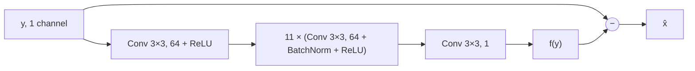
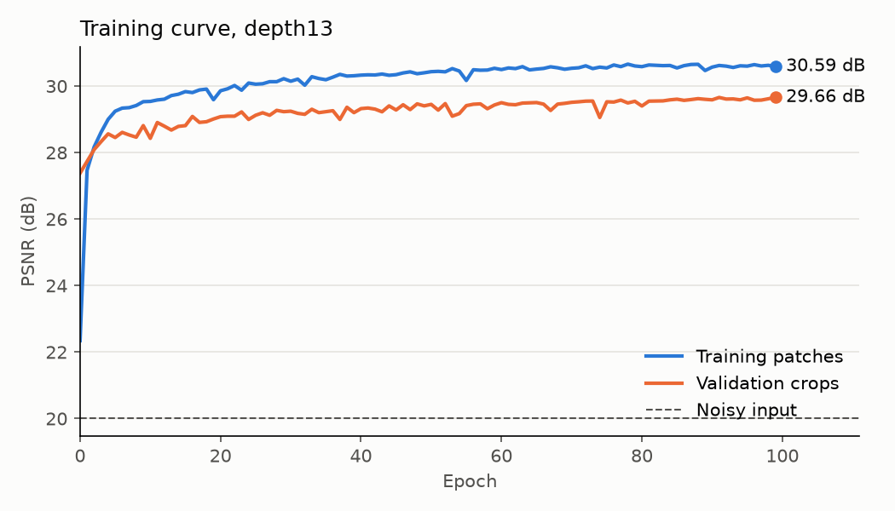
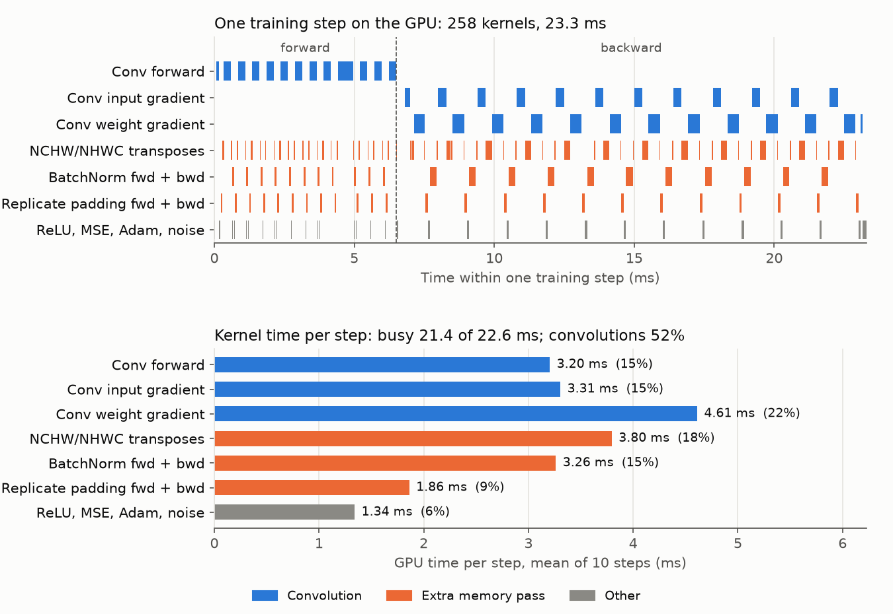
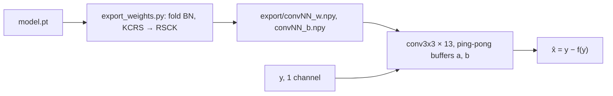
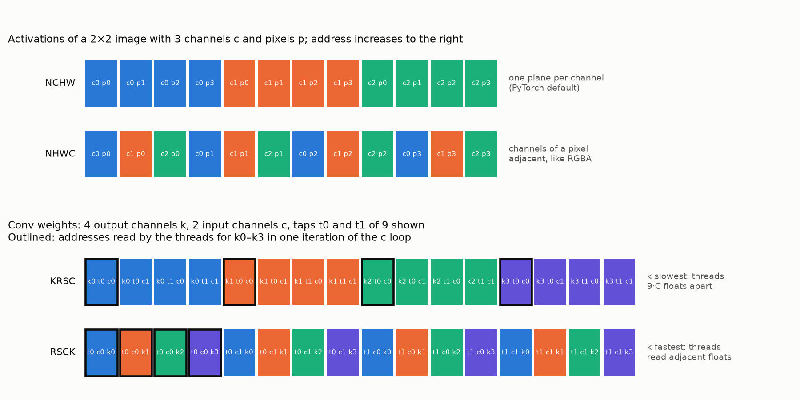
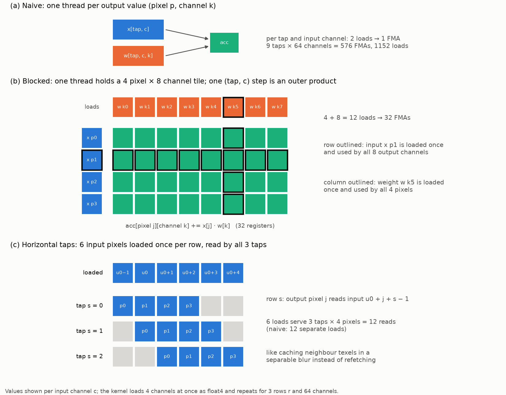

# 02 — Neural denoising

**Track:** PC series (M2) · **Status:** In progress

A compact residual CNN, trained in PyTorch on natural photographs with synthetic Gaussian noise, for comparison with the classical filters of 00 and 01.

| Part | Content | Status |
|---|---|---|
| `prepare.py` | DIV2K PNG to linear one-channel `.npy` | Done |
| `dataset.py` | Random clean patches, noise added on the GPU | Done |
| `model.py` | DnCNN-style residual denoiser | Done |
| `train.py`, `plot.py` | Training loop, validation curve | Done |
| `profile_step.py` | Nsight Systems capture of training steps | Done |
| `export_weights.py`, `CudaNeuralDenoising/Inference` | Hand-written CUDA forward pass, compared with PyTorch | Naive version done |
| `CudaNeuralDenoising/Training` | Hand-written CUDA training step | Pending |
| Evaluation | Comparison with noisy input, Gaussian and NLM on a test set not used in training | Pending |
| Inference study | Model size, inference time, failure cases | Pending |

```bash
python -m venv .venv                 # then activate .venv
pip install torch --index-url https://download.pytorch.org/whl/cu134
pip install numpy matplotlib pillow pytest
python prepare.py                    # once, after downloading DIV2K into data/
python -m pytest                     # correctness tests; DIV2K tests skip without data/gray/
python train.py                      # writes runs/depth13/: config.json, curve.csv, model.pt
python plot.py                       # writes runs/depth13/curve.png
nsys profile --capture-range=cudaProfilerApi --trace=cuda,nvtx,cuDNN -o runs/profile_step python profile_step.py
python export_weights.py             # writes runs/depth13/export/: folded weights, test input, PyTorch output
# then build CudaNeuralDenoising/CudaNeuralDenoising.sln (Release x64) and run it from runs/depth13/
```

## Problem

Same noise model as [00](../00-image-baseline/README.md): one linear channel, additive Gaussian noise, no clipping.

$$y = x + \sigma z, \qquad z \sim \mathcal{N}(0, 1), \qquad \sigma = 0.1$$

$$\mathrm{MSE} = \frac{1}{N} \sum_p \left(\hat{x}_p - x_p\right)^2, \qquad \mathrm{PSNR} = 10 \log_{10} \frac{1}{\mathrm{MSE}}$$

The noisy input has $\mathrm{MSE} = \sigma^2 = 0.01$, which is 20 dB.

## Data

[DIV2K](https://data.vision.ee.ethz.ch/cvl/DIV2K/) high-resolution images: 800 for training, 100 held out for validation, split by image. The dataset is provided for academic research only, and copyright remains with the original owners. Images and derived files stay in the gitignored `data/` folder and are not redistributed; no figure contains DIV2K content.

| Archive | Size | Extract to |
|---|---|---|
| `DIV2K_train_HR.zip` | 3.5 GB | `data/DIV2K_train_HR/` |
| `DIV2K_valid_HR.zip` | 0.45 GB | `data/DIV2K_valid_HR/` |


$$c_{lin} = \begin{cases} c / 12.92 & c \le 0.04045 \\ \left((c + 0.055) / 1.055\right)^{2.4} & c > 0.04045 \end{cases} \qquad Y = 0.2126 R + 0.7152 G + 0.0722 B$$

Mean linear brightness of the training set: 0.245. At $\sigma = 0.1$ the noise is strong relative to the signal, and PSNR values are not comparable with the synthetic patterns of 00.

Noise is drawn anew for every batch, so no noisy patch is seen twice. Validation uses one fixed 256×256 centre crop per held-out image with fixed noise (seed 0), so every epoch is measured on identical inputs.

## Model

The network $f$ estimates the noise, which is then subtracted (residual learning, [DnCNN](https://arxiv.org/abs/1608.03981)):

$$\hat{x} = y - f(y)$$



One convolution layer maps $C_{in}$ input channels to 64 output channels with learned 3×3 weights:

$$o_c(p) = b_c + \sum_{c'=1}^{C_{in}} \sum_{k \in \lbrace -1, 0, 1 \rbrace^2} w_{c, c', k} \cdot v_{c'}(p + k)$$

| Operation | Definition | Role |
|---|---|---|
| ReLU | $\max(0, v)$ | Nonlinearity; without it the stack reduces to one linear filter |
| BatchNorm | $\gamma \cdot (v - \mu) / \sqrt{\sigma_B^2 + \epsilon} + \beta$ per channel | $\mu$ and $\sigma_B^2$ over the batch during training, running averages at inference |
| Padding | `replicate` | Clamp boundary, as in 00 and 01 |

Each 3×3 layer extends the receptive field by one pixel per side. With depth $d = 13$ it matches the NLM window of 01 ($S = 10$, $P = 3$):

$$R = 2d + 1 = 27 = 2(S + P) + 1$$

| Layer | Parameters |
|---|---|
| First conv, with bias | $9 \cdot 64 + 64 = 640$ |
| 11 × (conv without bias + BatchNorm) | $11 \cdot (9 \cdot 64^2 + 2 \cdot 64) = 406{,}912$ |
| Last conv | $9 \cdot 64 = 576$ |
| Total | 408,128, or 1.56 MiB as float32 | The network is fully convolutional, so it is trained on patches and applied to images of any size.

## Training

```
w = random initialisation
for epoch in 1..100:
    for each batch of 32 random 64×64 clean patches x:      # 400 batches
        y = x + σ·z                                         # new z every batch
        L = mean((y − f(y; w) − x)²)                        # forward pass
        g = ∂L/∂w                                           # backward pass
        w = Adam(w, g, lr)                                  # weight update
    valid MSE on the 100 fixed crops, BatchNorm in inference mode
save w
```

| Setting | Value |
|---|---|
| Loss | MSE |
| Optimiser | Adam, learning rate $10^{-3}$, constant |
| Batch | 32 patches of 64×64 |
| Epoch | 800 images × 16 patches = 12,800 patches |
| Epochs | 100 |
| Seed | 0 (weights, crops, validation noise) |

## Correctness

`tests/test_denoiser.py`, 10 tests, all passing on the laptop (3.3 s):

| Check | Result |
|---|---|
| sRGB to linear at 0, 0.04045, 0.5, 1 against the standard | Within 1e-5 |
| Luma of uniform white, red and green images | 1, 0.2126, 0.7152 |
| Stored `.npy` against a fresh PNG decode, first and last image of each split | Identical |
| Train and validation file names | Disjoint, 800 / 100 |
| Patch of an image with unique pixel values against the source window | Identical |
| Added noise, 262,144 samples | Mean and standard deviation within 1e-3 of 0 and 0.1; redrawn per call |
| Parameter count against the formula | 408,128 |
| Output size follows input, 64×64 and 128×300 | Pass |
| Receptive field from the gradient of one output pixel, depth 5 / 13 | 11 / 27 |
| Last layer zeroed, so f(y) = 0 | Output equals input |

Measured once outside the tests: all 800 training images lie in [0, 1] and are finite; noise on a training batch has mean −0.000031 and standard deviation 0.100034; depth 17 has a 35×35 receptive field.

## Results

Laptop GPU, one training run with the settings above.



| Input | Validation PSNR (dB) |
|---|---|
| Noisy | 20.00 |
| Network, epoch 100 | 29.66 |

| Timing | Value |
|---|---|
| Training, 100 epochs including validation | 983 s |
| Epoch, steady state | 9.8 s |
| Epoch 0, including warm-up | 10.2 s |
| Loading the training set into RAM | 13.5 s |
| Data loading, noise and transfer, one epoch without the model | 0.31 s |

Validation PSNR was still rising at epoch 100. The comparison with Gaussian and NLM on a test set is pending.

## Training profile

`profile_step.py`: one fixed batch of 32 random 64×64 patches already on the GPU (data loading measured separately: under 1 ms per step), 20 warm-up steps, then 10 steps captured with Nsight Systems. Kernel times from `nsys stats --report cuda_gpu_trace --format csv`.



| Quantity per step | Value |
|---|---|
| Kernels | 258 |
| GPU busy / span | 21.4 / 22.6 ms (95%) |
| NCHW↔NHWC transposes | 106 launches |
| Convolution work, forward + backward | ≈ 320 GFLOP, ≈ 29 TFLOP/s achieved |

The GPU is idle 5% of the step, so host-side launch overhead is not the limit. The convolutions run on TF32 tensor cores (`s1688fprop/dgrad_…_tf32`); the 1-channel first and last layers use FP32 kernels without tensor cores (`implicit_convolve_sgemm`, `wgrad_alg0_engine`). 42% of the kernel time is spent in passes that only move data:

| Extra pass | Cause | Share |
|---|---|---|
| Layout transposes | PyTorch stores NCHW, the tensor-core kernels use NHWC | 18% |
| BatchNorm | Separate read and write of every activation, forward and backward | 15% |
| Replicate padding | cuDNN convolutions pad with zeros only; clamp padding is a separate copy | 9% |

A fused implementation (NHWC throughout, clamp addressing inside the convolution, normalisation and ReLU applied in the convolution epilogue) removes these passes.

## CUDA inference

At inference, BatchNorm uses fixed running statistics and reduces to a per-channel affine map, which is folded into the preceding convolution:

$$s_k = \frac{\gamma_k}{\sqrt{v_k + \epsilon}}, \qquad w'_k = s_k w_k, \qquad b'_k = s_k (b_k - \mu_k) + \beta_k$$

Each layer is then one kernel: clamp padding, 3×3 convolution, bias, ReLU. The last layer writes $\hat{x} = y - f(y)$ directly.



```
conv3x3, one thread per output value (pixel p = (u, v), output channel k):
    acc = b[k]
    for r, s in 3×3:                                    # clamp addressing, no padded copy
        x = in[clamp(v + r − 1), clamp(u + s − 1), :]   # NHWC: C channels contiguous
        acc += Σ_c w[r, s, c, k] · x[c]                 # RSCK: k contiguous
    out[p, k] = relu(acc)            or, last layer: y[p] − acc
```

### Memory layout



Consecutive threads of a warp hold consecutive output channels $k$ of one pixel. The input value $x_c$ is then the same address for the whole warp (broadcast). The weight read is one coalesced transaction with $k$ fastest (RSCK), or 32 separate transactions with $k$ slowest (KRSC), where neighbouring threads are $9C$ floats apart.

### Correctness

| Check | Result |
|---|---|
| Folded network (PyTorch ops, float64) against the trained model, 256² crop | max abs 2.28e-7 |
| CUDA forward pass against the PyTorch model output, same crop | max abs 7.15e-7 |

The test input is the 256×256 centre crop of validation image 0801 with fixed noise (seed 0).

### Timing

Forward pass of the whole network, GPU time from CUDA events per pass, minimum of 50 (256²) or 9 (2048²) passes after at least 1 s / 3 s of warm-up. `Inference` itself prints the mean of 20 / 5 passes after one warm-up pass (2622 and 2626 ms at 2048² in two runs in stable power state). The GPU is held in D3D12 stable power state ([D3D12StablePower](../../../tools/D3D12StablePower/), SM clock 930–1080 MHz), and all rows were measured in one session.

| Implementation | 256² | 2048² | 2048², relative to PyTorch |
|---|---|---|---|
| PyTorch, cuDNN, eval mode | 6.80 ms | 696 ms | 1.0 |
| CUDA naive, RSCK weights | 41.7 ms | 3106 ms | 4.5 |
| CUDA naive, KRSC weights | 352.8 ms | 23265 ms | 33.4 |

The weight layout alone accounts for a factor of 7.5 at 2048² (KRSC against RSCK).

The network performs ≈ 0.81 MFLOP per pixel ($11 \cdot 9 \cdot 64^2$ multiply-adds in the middle layers), 3.4 TFLOP per 2048² image.

### Register blocking

The naive kernel issues two loads per FMA. `conv3x3_blocked<C, K, TP, TK>` (middle 64→64 layers) gives each thread a tile of TP = 4 consecutive pixels × TK = 8 output channels, held in 32 accumulator registers. Each (tap, input channel) step is then an outer product of 4 inputs and 8 weights: 12 loads feed 32 FMAs.



```
conv3x3_blocked, one thread per (row v, pixels u0 … u0+3, channels k0 … k0+7):
    acc[4][8] = b[k0 … k0+7]
    for r in 0..2:
        for c in 0..C step 4:
            x[0..5] = float4 in[clamp(v + r − 1), clamp(u0 − 1 … u0 + 4), c … c+3]
            for s in 0..2, cc in 0..3:
                wk[0..7] = 2 × float4 w[r, s, c + cc, k0 … k0+7]
                acc[j][k] += x[j + s][cc] · wk[k]      for j < 4, k < 8
    out[v, u0 + j, k0 + k] = relu(acc[j][k])          as float4
```

| Layer 1, 2048², Nsight Compute | Naive | Blocked |
|---|---|---|
| Cycles | 248.9M | 36.5M |
| Instructions | 47.8G | 5.63G |
| FP32 throughput, of peak | 6% | 40% |
| Registers per thread / occupancy | 40 / 91% | 80 / 50% |
| L1 hit / L2 hit | 97% / 95.7% | 93.2% / 66.7% |
| Global load bytes used per 32-byte sector | | 15.9 |

| Check / timing | Result |
|---|---|
| CUDA forward pass with blocked layers against PyTorch, 256² crop | max abs 8.79e-7 |
| Blocked / naive whole pass, 256² | 0.219 (4.30 / 19.65 ms) |
| Blocked / naive whole pass, 2048² | 0.162 (364 / 2256 ms) |

Timings are minima over alternating naive / blocked passes in one run (20 pairs at 256², 4 at 2048²), without stable power state. The first and last layers (1 input or 1 output channel) remain naive.

## Environment

NVIDIA GeForce RTX 5090 Laptop GPU (`sm_120`), driver 621.01, Windows 11. Python 3.13.5, PyTorch 2.15.0+cu134 (CUDA 13.4 runtime, cuDNN 9.26), NumPy 2.5.4, Matplotlib 3.11.2, Pillow 13.0.0, pytest 9.2.0. CUDA 13.4, Visual Studio 2022, Nsight Systems 2026.5.1.
