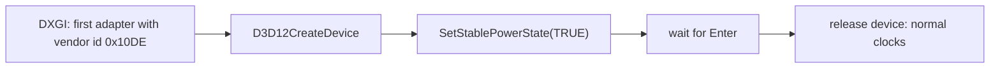

# D3D12StablePower

Holds the NVIDIA GPU at a fixed clock while GPU timings are taken.

`ID3D12Device::SetStablePowerState(TRUE)` disables dynamic clock boosting for as long as the device exists. The lock applies to the whole GPU, so CUDA programs started meanwhile in other processes run at the same fixed clock.



| Requirement | Value |
|---|---|
| OS setting | Windows Developer Mode enabled |
| Build | `D3D12StablePower.sln`, x64, console; `d3d12.lib` and `dxgi.lib` are linked through `#pragma comment` |

```bash
D3D12StablePower.exe      # keep open; run the timing program; press Enter to release
```

The adapter is selected explicitly, because the default adapter on laptops can be the integrated GPU.

## Measured effect

RTX 5090 Laptop GPU, driver 621.01, SM clock read with `nvidia-smi --query-gpu=clocks.sm`:

| State | SM clock |
|---|---|
| Default, idle to load | 1680–2212 MHz |
| Stable power state, under CUDA load | 930–1080 MHz |

The clock is held near base clock, so absolute timings are slower than in the default state. Run-to-run spread is reduced, but not removed; the clock also dips under sustained load (930 MHz observed). Timings are therefore reported as the minimum of several passes after a warm-up.
